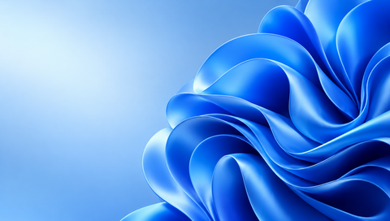

# Windows 11 PSP Theme — Work in progress

**Designed & Developed by Amir Saeid Dehghan**

This repository contains early design assets for an unofficial Windows 11-inspired PSP theme. **There is no installable PTF or release yet.** The wallpaper and seven editable draft category icons have not been integrated or verified on a PSP. They are design sources, not screenshots of a functioning theme.

## Project status

- Original AI-generated Bloom-inspired wallpaper, provided at source resolution and at 480 × 272 pixels.
- Seven editable, preliminary SVG category icons for Settings, Photo, Music, Video, Game, Network and Extras.
- PTF building, submenu assets, PSP Go fallback mapping, PTF validation, screenshots, bilingual installation documentation and a release remain unfinished.
- No firmware, emulator, physical PSP, or model-specific profile has been tested. Compatibility must not be assumed.

## Technical direction

Standard PTF changes supported theme resources, not the PSP operating system or XMB layout. PTF Studio 1.0 documents PSP Go entries System Storage, Saved Data Utility — System Storage and Resume Game as using the first-level fallback; it warns against inventing records 60–65. Check actual hardware before claiming support. See [validation notes](docs/VALIDATION.md).

## Files

- `wallpapers/` — generated source artwork and 480 × 272 conversion.
- `icons/` — draft editable SVG artwork; not packaged as PTF resources.
- `scripts/make_icons.py` — generates the SVG drafts.
- `docs/VALIDATION.md` — current verification status and next steps.

Windows and PlayStation are trademarks of their respective owners. This is an independent fan project, not affiliated with Microsoft or Sony.

---

# تم ویندوز ۱۱ برای PSP — در حال ساخت

**طراحی و توسعه: امیر سعید دهقان**

این مخزن شامل منابع اولیه یک تم غیررسمی الهام‌گرفته از ویندوز ۱۱ است. **هنوز فایل قابل نصب PTF یا نسخه نهایی منتشر نشده است.** تصویر زمینه و هفت آیکون اولیه هنوز داخل تم قرار نگرفته‌اند و روی PSP آزمایش نشده‌اند.

تصویر زمینه در ابعاد اصلی و در اندازه ۴۸۰ × ۲۷۲ و آیکون‌های قابل ویرایش SVG در پوشه‌های پروژه موجودند. ساخت و بررسی فایل PTF، طراحی آیکون‌های منوهای فرعی، تهیه تصاویر واقعی از پیش‌نمایش، مستندات نصب و آزمایش مدل‌ها هنوز باقی مانده است.

در PSP Go بعضی ورودی‌های اختصاصی ممکن است از آیکون جایگزین مشترک استفاده کنند؛ سازگاری نهایی باید روی دستگاه بررسی شود. هیچ مدل یا نسخه فریموری تاکنون آزمایش نشده است.

این پروژه مستقل است و وابستگی رسمی به مایکروسافت یا سونی ندارد.

