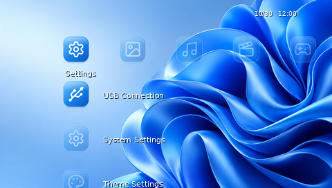
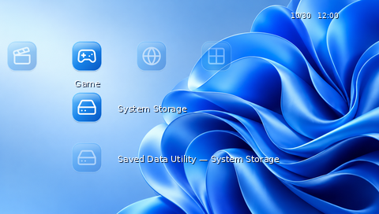

# Windows 11 PSP Theme

**Designed & Developed by Amir Saeid Dehghan**

An unofficial Windows 11-inspired theme for the PSP XrossMediaBar, using blue Bloom-inspired artwork and Fluent-inspired icons. This is a **0.9.0 test build**: its PTF resources have been decoded and structurally checked, but the theme has not been tested on a physical PSP, emulator, or particular firmware. Please report results before treating it as a universal, production-ready release.

[Download the PTF](dist/Windows_11_PSP_Theme.ptf) · [Download test ZIP](releases/Windows_11_PSP_Theme_v0.9.0.zip) · [Validation report](docs/VALIDATION.md)




These are **software-drawn approximations** using the project artwork, not screenshots from PSP hardware or an emulator. Firmware fonts, icon behavior and placement can differ. More previews: [gallery](screenshots/).

## Features and compatibility

- Standard PTF with 480 × 272 wallpaper, eight category icons, 29 paired first-level icons, two paired second-level icons, preview thumbnail and preview image.
- Palette-based transparent icon resources; focus images contain a white outer glow. PSP functionality and XMB layout remain firmware-controlled.
- Intended for PSP-1000/2000/3000, PSP Go (N1000), and PSP Street (E1000) on firmware supporting standard PTF. **None of these models or firmware versions has been tested**, including 6.60 and 6.61. Available menu entries depend on model and region.
- PSP Go: PTF Studio documents System Storage, Saved Data Utility — System Storage and Resume Game as using a common first-level fallback. This theme supplies that fallback rather than adding unsupported slots. Test on a real PSP Go to establish behavior.
- Optional dark and minimal wallpapers are separate PNGs in `wallpapers/`; they are **not** additional PTF builds.

## Installation

1. Download `Windows_11_PSP_Theme.ptf` from `dist/` or the test ZIP.
2. Connect the PSP in USB mode, or access compatible storage on a computer.
3. Open the device storage, create `PSP/THEME/` if necessary, and copy the PTF into it.
4. Eject safely. On the PSP select **Settings → Theme Settings → Theme**, then choose the theme.
5. On PSP Go, connect and select its **internal system storage** on the computer, then use that storage's `PSP/THEME/` folder. A compatible Memory Stick can also be used if available.
6. To revert, open the same Theme menu and choose the original/default theme.

This is a standard PTF and is intended to be used without custom firmware or CXMB. It does not replace the operating system, add a working Windows taskbar or Start menu, or change the XMB layout.

## Build and inspection

Requirements: Python 3, Pillow and Inkscape on PATH. From the repository root:

```sh
python3 scripts/render_assets.py
python3 scripts/build.py
python3 scripts/validate.py
```

`render_assets.py` rasterizes the editable SVG artwork and generates simulated previews. `build.py` creates a standard PTF container with GIM and BMP resources. `validate.py` checks the container's records, offsets, compression, signatures, and wallpaper dimensions; it does **not** prove hardware compatibility. For an independent decode, use [LibPSPThemes](https://github.com/GeofrontTeam/LibPSPThemes) with `ptf.py -c` and compare the exported resources. See [validation report](docs/VALIDATION.md) for what was actually checked.

The internal first-level body and focus canvases are 48 × 48 and 64 × 64 respectively; second-level canvases are 32 × 32 and 48 × 48. Category canvases are 64 × 48. This follows the role sizing documented by PTF Studio's source rather than assuming every converter uses identical dimensions.

`source/` holds editable SVGs and the slot mapping; `assets/` holds rendered PTF inputs; `wallpapers/` contains source and optional variants; `scripts/` contains the build and checks; `dist/`, `screenshots/`, `docs/`, and `releases/` contain the outputs and documentation. Read [credits](CREDITS.md) and [third-party notices](THIRD_PARTY_NOTICES.md).

Windows, Microsoft, PlayStation and PSP are trademarks of their respective owners. This independent project is not affiliated with Microsoft or Sony.

---

<div dir="rtl">

# تم ویندوز ۱۱ برای PSP

**طراحی و توسعه: امیر سعید دهقان**

این تم غیررسمی ظاهر ویندوز ۱۱ را با تصویر زمینه الهام‌گرفته از Bloom و آیکون‌های الهام‌گرفته از Fluent به رابط XMB پی‌اس‌پی می‌آورد. نسخه موجود **آزمایشی ۰.۹.۰** است: ساختار PTF و منابع تصویری آن به‌صورت نرم‌افزاری بررسی شده‌اند، اما روی دستگاه واقعی، شبیه‌ساز یا نسخه مشخصی از فریمور آزمایش نشده است.

[دریافت فایل PTF](dist/Windows_11_PSP_Theme.ptf) · [دریافت بسته آزمایشی ZIP](releases/Windows_11_PSP_Theme_v0.9.0.zip) · [گزارش بررسی](docs/VALIDATION.md)

تصاویر بالا و پوشه تصاویر، **پیش‌نمایش‌های شبیه‌سازی‌شده** هستند و عکس یا اسکرین‌شات دستگاه واقعی نیستند. ظاهر فونت و بعضی جزئیات در کنسول ممکن است متفاوت باشد.

## ویژگی‌ها و سازگاری

تم شامل تصویر زمینه ۴۸۰ × ۲۷۲، هشت آیکون دسته اصلی، ۲۹ جفت آیکون سطح اول، دو جفت آیکون سطح دوم و تصویر و آیکون پیش‌نمایش تم است. فایل برای سیستم استاندارد تم PTF طراحی شده و قابلیت‌های واقعی PSP را تغییر نمی‌دهد.

مدل‌های هدف PSP-1000، PSP-2000، PSP-3000، PSP Go و PSP Street هستند؛ **هیچ‌کدام هنوز آزمایش نشده‌اند** و سازگاری آن‌ها یا فریمورهای ۶٫۶۰ و ۶٫۶۱ تأیید نشده است. در PSP Go مواردی مانند حافظه داخلی و Resume Game ممکن است از آیکون جایگزین مشترک استفاده کنند. تم آیکون جایگزین را دارد، ولی رفتار نهایی باید روی دستگاه آزمایش شود.

دو تصویر زمینه تیره و آبی ساده به‌صورت PNG جداگانه در پوشه `wallpapers` قرار دارند و نسخه PTF جداگانه نیستند.

## آموزش نصب

۱. فایل `Windows_11_PSP_Theme.ptf` را دانلود کن.

۲. PSP را در حالت USB به کامپیوتر وصل کن یا به حافظه سازگار آن دسترسی پیدا کن.

۳. در حافظه دستگاه پوشه `PSP/THEME/` را باز کن؛ اگر وجود ندارد آن را بساز و فایل PTF را داخلش کپی کن.

۴. حافظه را با خیال راحت جدا کن. در PSP به **Settings → Theme Settings → Theme** برو و تم را انتخاب کن.

۵. برای PSP Go، در کامپیوتر **حافظه داخلی دستگاه** را باز کن و فایل را در پوشه `PSP/THEME/` همان حافظه قرار بده؛ در صورت وجود، حافظه جانبی سازگار نیز قابل استفاده است.

۶. برای بازگشت، به همان منوی Theme برو و تم اصلی یا پیش‌فرض را انتخاب کن.

این تم برای سیستم استاندارد PTF در نظر گرفته شده و به نصب CFW یا CXMB نیاز ندارد. منوی استارت، تسک‌بار واقعی یا سیستم‌عامل ویندوز به PSP اضافه نمی‌کند.

## ساخت مجدد و فایل‌ها

با نصب Python 3، کتابخانه Pillow و برنامه Inkscape، دستورهای بخش انگلیسی Build را از ریشه پروژه اجرا کن. سورس آیکون‌های SVG و نگاشت آن‌ها در `source`، فایل‌های آماده در `assets`، تصاویر زمینه در `wallpapers`، اسکریپت‌ها در `scripts` و خروجی آزمایشی در `dist` قرار دارند. گزارش بررسی دقیق در `docs/VALIDATION.md` است.

این پروژه مستقل و غیررسمی است و ارتباطی با شرکت‌های مایکروسافت یا سونی ندارد.

</div>
